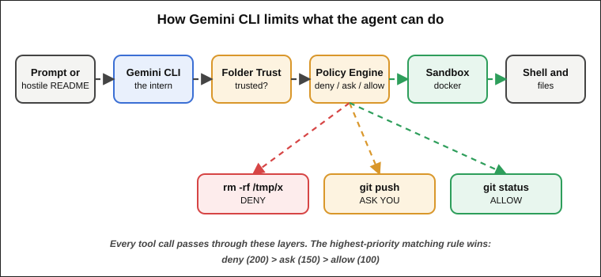
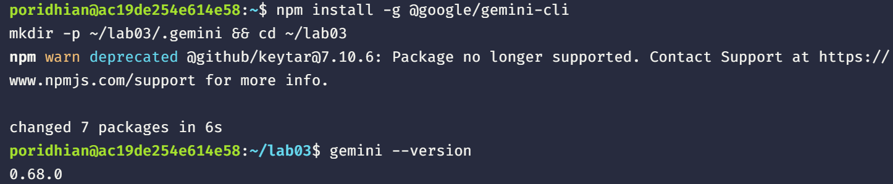
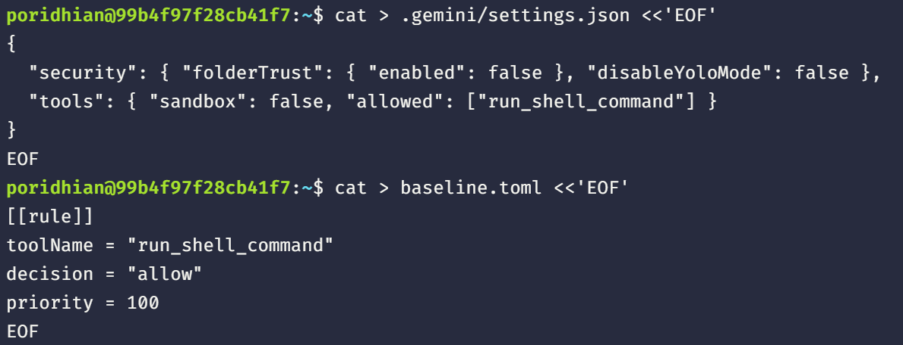

## Agent Execution Controls & Policy Security

## Introduction

It's your second week at the startup. The security lead stops by your desk:

> _"A teammate set up Gemini CLI last month and told me it 'just works.' That's what worries me. Check what it's allowed to do on that machine, and lock it down."_

Gemini CLI is not just a chatbot. It can run shell commands with **your** permissions. If one bad prompt can make it run `rm -rf ~`, then your laptop's safety depends on its configuration.

**Time:** 40 minutes | **You need:** a Linux VM, Node.js 20+, Python 3.11+

## By the end of it you'll know how Folder Trust, the sandbox and the Policy Engine limit an AI agent, and you'll have written a safe configuration.



## Chapter 1 — What can the agent actually do?

Think of Gemini CLI as a very fast intern at your terminal. The intern can type any command you can. What matters is the rules you set:

| Control             | The intern analogy                                       | Risky setting                  |
| ------------------- | -------------------------------------------------------- | ------------------------------ |
| **Folder Trust**    | Which rooms they may enter                               | Turned off                     |
| **Sandbox**         | Working in a padded room, so mistakes break nothing real | Off                            |
| **YOLO mode**       | "Never ask me, just do it"                               | Enabled                        |
| **`tools.allowed`** | Tasks you pre-signed in advance                          | Every shell command pre-signed |
| **Policy Engine**   | A written rulebook: never, ask first, or fine            | No `deny` rules                |

> **Why does this matter?** A hostile README can ask the intern to do something just as easily as you can. The rules are your only protection if the intern is fooled.

Install Gemini CLI and make a lab folder:

```
npm install -g @google/gemini-cli
mkdir -p ~/lab03/.gemini && cd ~/lab03
```



> **A note on versions:** Gemini CLI changes quickly. If a setting isn't recognised, check https://geminicli.com/docs for your version.

## Chapter 2 — Meet the vulnerable setup

Create your teammate's configuration:

```
cat > .gemini/settings.json <<'EOF'
{
  "security": { "folderTrust": { "enabled": false }, "disableYoloMode": false },
  "tools": { "sandbox": false, "allowed": ["run_shell_command"] }
}
EOF
```

```
cat > baseline.toml <<'EOF'
[[rule]]
toolName = "run_shell_command"
decision = "allow"
priority = 100
EOF
```



Before reading on, look at both files and write down what you think is wrong.

## Chapter 3 — What's wrong with it?

| #   | Finding                                   | Why it's dangerous                                              |
| --- | ----------------------------------------- | --------------------------------------------------------------- |
| 1   | Folder Trust is off                       | A cloned repo can load its own hooks and servers without asking |
| 2   | `sandbox` is `false`                      | A bad command runs directly on your machine                     |
| 3   | All shell commands are in `tools.allowed` | Every command runs without a prompt                             |
| 4   | `disableYoloMode` is `false`              | Anyone can switch on "never ask" mode                           |
| 5   | The policy allows every shell command     | Nothing blocks `rm -rf` or `sudo`                               |

> **The mental model:** the setup isn't broken by one mistake. It has no layers left.

## Chapter 4 — Build the safe version

**Safe settings:**

```
cat > .gemini/settings.json <<'EOF'
{
  "security": { "folderTrust": { "enabled": true }, "disableYoloMode": true },
  "tools": {
    "sandbox": "docker",
    "allowed": ["run_shell_command(git status)", "run_shell_command(git diff)"]
  }
}
EOF
```

Only two read-only Git commands skip the prompt. Everything else asks you first.

**Safe rulebook.** The Policy Engine picks the matching rule with the **highest priority**:

```
cat > secure.toml <<'EOF'
[[rule]]
toolName = "run_shell_command"
commandPrefix = ["rm -rf", "sudo"]
decision = "deny"
priority = 200

[[rule]]
toolName = "run_shell_command"
commandPrefix = "git push"
decision = "ask_user"
priority = 150

[[rule]]
toolName = "run_shell_command"
commandPrefix = ["git status", "git diff", "git log"]
decision = "allow"
priority = 100
EOF
```

Three tiers: **deny** is highest, **ask** is in the middle, **allow** is lowest.

> **Where do policies live?** Keep your rulebook in `~/.gemini/policies/`, in your home folder. Gemini CLI doesn't enforce project-level policies yet, so a rule file a repository ships wouldn't protect you.

> **Why priorities?** If `git status` matched both an allow rule and a broad deny rule, the higher number decides. That's how a strict `deny` can't be overridden by a loose `allow`.

## Chapter 5 — Check your work

First, make sure both files are valid:

```
python3 -c "import json;json.load(open('.gemini/settings.json'));print('settings OK')"
python3 -c "import tomllib;print(len(tomllib.load(open('secure.toml','rb'))['rule']),'rules loaded')"
```

You should see `settings OK` and `3 rules loaded`.

Now predict what the policy does with each command, then check your answers:

run `gemini` then give any of the following command to check.

| Command                   | Decision     | Which rule                           |
| ------------------------- | ------------ | ------------------------------------ |
| `rm -rf /tmp/x`           | **deny**     | Priority 200                         |
| `sudo apt update`         | **deny**     | Priority 200                         |
| `git push origin main`    | **ask_user** | Priority 150                         |
| `git status`              | **allow**    | Priority 100                         |
| `curl http://example.com` | **ask**      | No rule matches, so the default asks |

## Chapter 6 — The real test (optional)

If you're signed in to Gemini CLI, copy the rulebook in and try it:

```
mkdir -p ~/.gemini/policies && cp secure.toml ~/.gemini/policies/
gemini
```

Ask `run rm -rf /tmp/lab03-test`. It should be blocked. Ask `run git push`. It should ask you first.

## You're ready for the next lab

- You found **five weaknesses** in an unsafe setup.
- You wrote **safe settings** and a **three-tier policy**.
- You **validated** both files and worked out what the policy does.

## Troubleshooting

- **`ModuleNotFoundError: tomllib`**: your Python is older than 3.11.
- **The sandbox won't start**: Docker isn't running. Check `docker ps`.
- **The policy has no effect**: the file must end in `.toml` and live in `~/.gemini/policies/` in your home folder. Project-level policies aren't enforced yet, so a copy inside the project folder is ignored.
- **Gemini CLI won't sign in**: the audit and checklist guidance is written for Code Assist Standard or Enterprise users, and consumer accounts have moved to Antigravity CLI. If you have no licence, skip the optional live test.

## Check your understanding

1. What does Folder Trust protect you from?
2. Why is allowing the whole `run_shell_command` tool dangerous?
3. When two rules match, which wins?
4. Why is `git push` set to `ask_user` instead of `deny`?

## Reference

This lab covers misconfigurations X2, X3, X4, X5 and X12 and checklist items B1–B7, C1, C2 and C4 from the AISecurityLabs.org Gemini guides: https://aisecuritylabs.org/resources/gemini-misconfigurations/ and https://aisecuritylabs.org/resources/gemini-checklist/

## Cleanup

```
rm -rf ~/lab03
```
