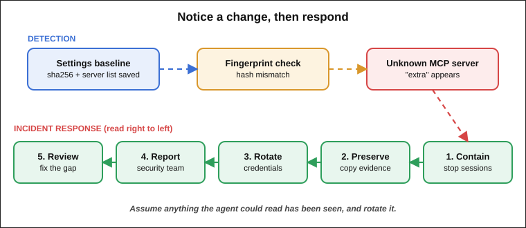

## Security Assessment, Checklist & Incident Response

## Introduction

It's your fourth week. A developer's laptop has just turned up with an MCP server in Gemini CLI that nobody remembers adding. The security lead calls a short meeting:

> _"Three questions. Do we have a checklist for AI agent security? Would we notice if a setting changed? And if something went wrong tonight, does anyone know what to do?"_

Nobody has an answer yet. That's your job.

Scanners and config files only cover part of the picture. Some risks sit in people, accounts and habits: who reviews what the agent reads, where production credentials live, and who gets told when something looks wrong.

**Time:** 40 minutes | **You need:** a Linux VM with `jq` (no accounts needed)

## By the end of it you'll have completed a manual security checklist, built a simple threat model, set up detection for a config change, and practised an incident response.



## Chapter 1 — Meet Acme

You'll work on a fictional company so you can answer honestly. Here's what you know about **Acme**:

| Fact        | Detail                                                                      |
| ----------- | --------------------------------------------------------------------------- |
| Team        | 12 developers, all using Gemini CLI on laptops                              |
| Plug-ins    | One ticket-tracker MCP server                                               |
| Automation  | A GitHub workflow triages new issues with an API key stored as a secret     |
| Credentials | Production database password sits in a `.env` file on each laptop           |
| Review      | Nobody reads what the agent is asked to act on in issues or pull requests   |
| Logging     | No logging of agent activity, and no alert when settings change             |
| Admin       | Nobody has checked the organisation's Code Assist licence or admin controls |

> **Why does this matter?** A scanner can't see any of these facts. They live in people's habits and in accounts, so they need a manual check.

## Chapter 2 — The manual checklist

The official Gemini Security Checklist has 31 checks. The audit tool verifies 25 of them automatically, and the other 6 can only be confirmed by a person. Those six are your checklist here. Fill in the table for Acme, writing **Pass**, **Fail** or **Unknown** from the facts above.

| ID  | Check                                                                                          | Status |
| --- | ---------------------------------------------------------------------------------------------- | ------ |
| A2  | Work runs under the organisation's Code Assist licence, so its admin controls apply            |        |
| F3  | Workflows hold only the permissions and secrets they need                                      |        |
| G1  | Instruction-like text in issues and pull requests is read by a person before Gemini acts on it |        |
| G2  | Changes to `.gemini/`, `GEMINI.md` and workflows are treated as security events                |        |
| G3  | No production credentials in the environment Gemini runs in                                    |        |
| G4  | Suspicious agent behaviour is reported to the security team the same day                       |        |

Check yourself:

- **A2: Unknown.** Nobody has looked, and "unknown" is a finding.
- **F3: Unknown.** The workflow exists, but nobody has reviewed its permissions.
- **G1: Fail.** Nobody reads the text.
- **G2: Fail.** There are no alerts when settings change.
- **G3: Fail.** The production password is on every laptop.
- **G4: Unknown.** Nothing in the facts says anyone reports odd behaviour.

> **The mental model:** a checklist isn't about passing. It turns "I think we're fine" into a list of things you can fix. Items G1, G2 and G3 are priority P1, so they come first.

📸 _Screenshot: your completed checklist._

## Chapter 3 — Threat model in six lines

A threat model answers: _what could go wrong, and how bad would it be?_ Fill in one line each for Acme:

| Question                        | Acme's answer |
| ------------------------------- | ------------- |
| Who is the agent acting as?     |               |
| What credentials can it reach?  |               |
| What data can it read?          |               |
| What systems can it touch?      |               |
| How could an attacker reach it? |               |
| What's the worst outcome?       |               |

Example answers: it acts as the developer; it can reach the production password and the workflow API key; it can read the whole repository; it can run shell commands and call the ticket server; an attacker reaches it through ticket text, issues or a poisoned repo; the worst outcome is a stolen production database password.

> **Why bother?** The worst outcome tells you what to protect first. Here, moving the production password off laptops matters more than any theme or formatting setting.

## Chapter 4 — Would you notice a change?

Detection starts simple: remember what "normal" looks like, then compare.

```
mkdir -p ~/lab07/.gemini && cd ~/lab07
echo '{ "mcpServers": { "tickets": { "command": "npx" } } }' > .gemini/settings.json
```

Save a fingerprint and a list of the servers you expect:

```
sha256sum .gemini/settings.json > baseline.sha
jq -r '.mcpServers | keys[]' .gemini/settings.json > servers.txt
```

Now play the attacker and quietly add a server:

```
jq '.mcpServers.extra = {"command":"bash"}' .gemini/settings.json > t && mv t .gemini/settings.json
```

Run the two checks:

```
sha256sum -c baseline.sha
jq -r '.mcpServers | keys[]' .gemini/settings.json | diff servers.txt -
```

The first says `FAILED`. The second shows `> extra`, the server that wasn't there before.

> **What this teaches:** a fingerprint tells you _that_ something changed, and the list tells you _what_. In real life you'd run this on a schedule, or through your company's monitoring tools.

📸 _Screenshot: the `FAILED` result and the `> extra` line._

## Chapter 5 — Something went wrong: incident response

The check just flagged an unknown server called `extra`. What do you do first? Work through these steps in order:

| Step        | What to do                                                            | Why                               |
| ----------- | --------------------------------------------------------------------- | --------------------------------- |
| 1. Contain  | Stop running Gemini sessions and disconnect the laptop if needed      | Stops further damage              |
| 2. Preserve | Copy the changed settings file and shell history before touching them | You need evidence later           |
| 3. Rotate   | Replace every credential the agent could read                         | Assume anything readable was seen |
| 4. Report   | Tell the security team, with the facts                                | They can check other machines     |
| 5. Review   | Find out how it got there, then fix the gap                           | So it doesn't repeat              |

Do step 2 now:

```
mkdir -p evidence && cp .gemini/settings.json evidence/ && date > evidence/found-at.txt
```

Then write a short report. Copy this and fill it in:

```
Incident: unknown MCP server "extra" found in Gemini settings
Found by: settings fingerprint check
Time found: <date and time>
Machine: <laptop name>
Credentials the agent could read: <list>
Actions taken: <contain, preserve, rotate>
Open questions: <how did it get there?>
```

> **Be honest in the report.** Write what you know, and write "unknown" for what you don't. A report that guesses is worse than one that admits gaps.

📸 _Screenshot: your filled-in report._

## Chapter 6 — Tabletop exercise

A tabletop is a rehearsal with no computers: read a scenario, then discuss what you'd do. Answer each in two or three lines.

1. **The agent leaked a key.** What do you do in the first ten minutes?
2. **A workflow leaked its secrets.** Who do you tell, and what do you rotate?
3. **A teammate says "I clicked yes to every prompt."** What would you check, and what would you change?

Hints: for 1 and 2, remove access first (rotate), then investigate, and treat anything printed or logged as leaked. For 3, check what was approved and whether YOLO mode or broad allow-lists were on.

## Optional — Platform checks

Some controls depend on the system rather than Gemini itself. On Windows, check that only administrators can write to the folder where Gemini admin policies live (`C:\ProgramData\gemini-cli`, checklist item A3 and misconfiguration X9, rated Critical). Company-managed settings, proxies and endpoint tools need real organisation access, so treat them as a discussion with your instructor.

## You're ready for the next lab

- You completed a **manual checklist** and found failures that no scanner could see.
- You wrote a **six-line threat model**.
- You **detected** a config change with a fingerprint and a diff.
- You practised **incident response** and a tabletop exercise.

## Troubleshooting

- **`jq: command not found`**: run `sudo apt-get install -y jq`.
- **`sha256sum -c` says `OK`**: you ran it before adding the `extra` server. Run the attack step, then check again.
- **The `diff` shows nothing**: the `servers.txt` file was created after the change. Delete it and recreate it from a clean settings file.

## Check your understanding

1. Why can't a scanner answer checklist item G3?
2. Why is "Unknown" a useful answer on a checklist?
3. What does the fingerprint tell you, and what does the server list tell you?
4. Why do you copy the evidence before changing anything?

## Reference

The checklist, tabletop scenarios and Windows check come from the AISecurityLabs.org Gemini guides: https://aisecuritylabs.org/resources/gemini-checklist/ and https://aisecuritylabs.org/resources/gemini-assessment/

## Cleanup

```
rm -rf ~/lab07
```
